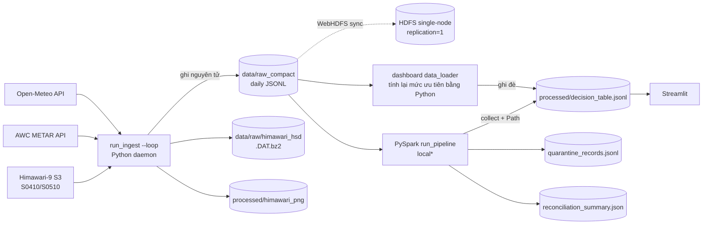

# 01 — Kiến trúc hiện trạng (trước đợt thay đổi 2026-11-16)

Tài liệu ghi lại hệ thống **trước** đợt tái cấu trúc, làm mốc để so sánh. Mọi nhận định đều dẫn tới tệp mã, dòng mã hoặc log tại thời điểm khảo sát (commit `2b6566f`).

## 1. Sơ đồ luồng dữ liệu

## 2. Thành phần

| Tầng | Thành phần | Ghi chú kiểm chứng |
|---|---|---|
| Thu nhận | `src/ingestion/run_ingest.py` (`--loop`): METAR 10′ (2 h look-back), Open-Meteo 60′, Himawari B13 10′ | Ghi qua `RawEnvelopeStore` có khóa `portalocker`. Mỗi batch viết lại nguyên tử shard cuối trong ngày (`raw_store.py:283-296`) |
| Bronze | `data/raw_compact/<nguồn>/date=YYYY-MM-DD/batches-NNNN.jsonl`, shard 64 MiB | Bản migration `--prune-legacy` đã xóa `data/raw/*.json`; `tests/spark/test_temporal_join.py` vẫn đọc đường dẫn cũ nên lỗi |
| HDFS | 1 NameNode và 1 DataNode `apache/hadoop:3`, `dfs.replication=1`, `permissions.enabled=false` | Chỉ nhận dữ liệu qua đồng bộ WebHDFS. Spark không đọc hay ghi trực tiếp |
| Xử lý | `src/spark/run_pipeline.py`, `local[*]`, `shuffle.partitions=4` | Đầu ra `.collect()` rồi ghi JSONL bằng `pathlib.Path`; không có Parquet |
| Ghép thời điểm | `src/spark/temporal_join.py` | Spine dựng bằng `spark.createDataFrame(list)`. Replay nhận dự báo `is_backfill` lấy về sau mốc. Nếu mọi METAR của một sân bay đều sau mốc thì dòng của sân bay đó bị mất khỏi spine |
| Phục vụ | `src/dashboard/data_loader.py` | Ở chế độ LIVE tự tính lại toàn bộ pipeline bằng Python (`_compute_slot_rows_from_raw`) và ghi đè tệp kết quả của Spark |

## 3. Bảy điểm lệch đã xác nhận ở giai đoạn A

| # | Điểm lệch | Kết luận |
|---|---|---|
| 1 | Thiếu Parquet | Xác nhận: `grep parquet src/` không có kết quả |
| 2 | Đầu ra không ghi được lên HDFS | Xác nhận, và **cả chiều đọc** cũng hỏng: `RawEnvelopeStore` chỉ đọc đĩa cục bộ |
| 3 | Volume ở mức MB | Xác nhận: Bronze METAR/Open-Meteo 3,4 MB; Himawari mỗi lượt quét 5,67 MB thô (B8) |
| 4 | WebHDFS 0,86 MB/s do chi phí theo từng tệp | Là giả thuyết; kiểm chứng ở B6 (`02-assessment.md`) |
| 5 | Dashboard tự tính mức ưu tiên | Xác nhận: hai đường tính, cùng ghi một tệp (ADR-003) |
| 6 | Replay nhận dự báo backfill lấy về muộn | Xác nhận trong mã (`temporal_join.py:111-114` cũ). Hiện chưa gây hậu quả vì ingestion chưa bao giờ đặt `is_backfill` cho Open-Meteo, nhưng là rò rỉ tiềm ẩn |
| 7 | Lượng mưa theo giờ của Open-Meteo là tổng giờ liền trước | Theo tài liệu Open-Meteo (biến hourly `precipitation`: "sum of the preceding hour"), nên giờ đích `floor(t)+1h` phủ khoảng `(floor(t), floor(t)+1h]` |

## 4. Lỗi vận hành phát hiện thêm khi khảo sát
- `cleanup_old_raw_segments` chỉ xóa `.DAT.bz2` nếu có tệp metrics kiểu cũ trong `raw/himawari_metrics/`. Sau migration, metrics nằm ở `raw_compact`, nên tệp thô **không bao giờ bị xóa** (rò rỉ khoảng 816 MB/ngày).
- Khi không tải được mốc yêu cầu, `run_himawari_slot_pipeline` lấy ảnh của mốc mới nhất có trên S3 nhưng **gắn nhãn thời gian của mốc yêu cầu**. Ảnh của thời điểm khác bị dùng làm bằng chứng cho mốc đó.
- Daemon thu nhận không chạy từ 2026-11-11 đến 2026-11-15: độ phủ Himawari bằng 0 và 142/144 chu kỳ METAR bị thiếu trong 24 h đầu khảo sát. Nguyên nhân là `RECEIVER_FAULT`, theo `src/diagnostics/gap_attribution.py`.
