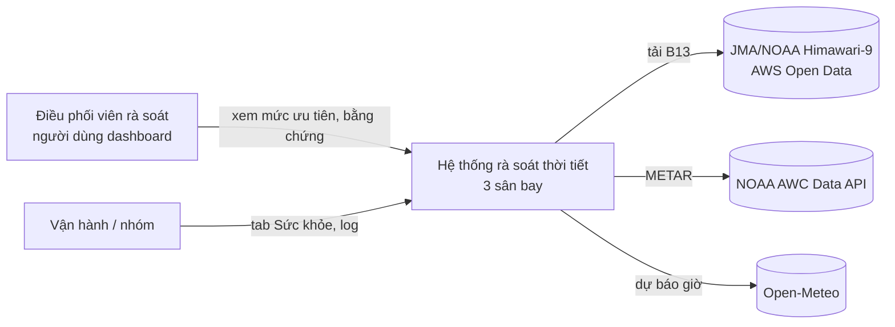
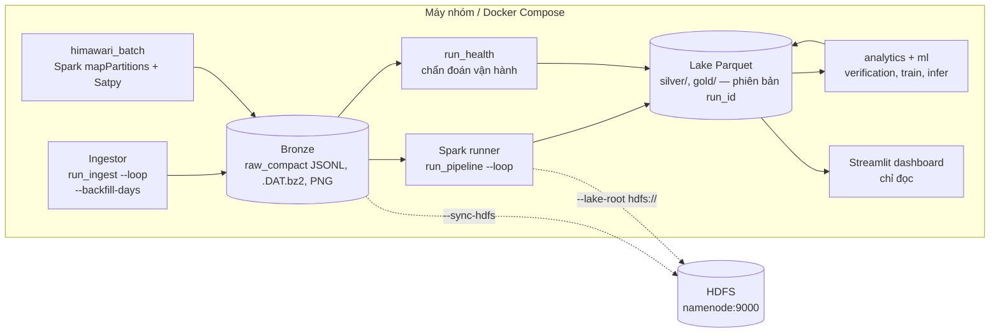

# 03 — Kiến trúc đích (đã triển khai)

## 1. C4 — Context



## 2. C4 — Container



## 3. Lake — bố cục và hợp đồng

```text
data/lake/
├── silver/
│   ├── metar_observations/run_id=<R>/date=YYYY-MM-DD/part-*.parquet
│   ├── open_meteo_forecasts/run_id=<R>/date=YYYY-MM-DD/...
│   ├── himawari_b13_metrics/run_id=<R>/date=YYYY-MM-DD/...
│   └── quarantine/run_id=<R>/part-*.parquet
├── gold/
│   ├── decision_table/run_id=<R>/review_date=YYYY-MM-DD/...
│   ├── reconciliation/run_id=<R>/...
│   ├── verification/  feature_table/  nowcast/
│   └── health/*.parquet + summary.json
└── _runner_heartbeat.json
```

- Một phiên bản chỉ hiển thị khi có `_SUCCESS`. Sau khi commit, giữ 2 phiên bản mới nhất (ADR-001).
- Đọc bằng Spark: `src.spark.writers.read_table(spark, lake_root, table)`.
- Đọc không cần Spark: `src.spark.lake_paths.local_table_version()` kết hợp pyarrow.
- Gold `decision_table` có thêm các cột:
  - `slot_kind` (`replay`/`live`);
  - `inputs_complete_at_utc` (thời điểm lấy về muộn nhất trong 3 nguồn);
  - `published_at_utc`, `first_published_at_utc` (giữ nguyên qua các lần chạy lại);
  - `b13_fetched_at_utc`, `run_id`.

## 4. Luồng chạy (runtime)

1. **Thu nhận liên tục.** `run_ingest --loop --include-himawari --retain-raw-hours N` ghi Bronze. Tệp thô `.DAT.bz2` được xóa sau khi đã trích chỉ số, trừ các mốc thuộc cửa sổ phát lại đã ghim.
2. **Công bố Gold.**
   - `run_pipeline --loop` giữ một SparkSession. Mỗi 15 s, nó so chữ ký Bronze; khi có thay đổi, chạy lại và commit Silver/Gold mới (ADR-004).
   - Khi không chạy runner, nút "Cập nhật dữ liệu realtime" chạy ingestion rồi chạy pipeline một lần (ADR-003).
3. **Dashboard.** Đọc phiên bản Gold mới nhất. Bộ theo dõi LIVE báo khi có phiên bản mới hơn phiên bản đang xem.
4. **Chẩn đoán.** `python -m src.diagnostics.run_health` ghi `gold/health`. Tab "Sức khỏe hệ thống" hiển thị kết quả.
5. **Phân tích nâng cao** (ADR-006):
   - `src.analytics.verification`: kiểm định Mức 1–4 và dự báo mưa;
   - `src.ml.train` và `src.ml.infer`: dự báo khả năng lên Mức 1 trong 0–60′; chỉ hiển thị khi vượt cổng chất lượng.
6. **Tải bù.**
   - `run_ingest --backfill-days N`: METAR, tối đa 30 ngày do giới hạn của AWC;
   - `python -m src.spark.himawari_batch --start --end --parallelism K`: Satpy chạy phân tán. Luôn tải đủ S0410 và S0510.

## 5. Ba trụ cột phân tích

| Trụ cột | Mã | Đầu ra |
|---|---|---|
| Chẩn đoán vận hành | `src/diagnostics/` | `gold/health/*`: SLA độ mới; độ phủ; nguyên nhân thiếu (SOURCE_MISSING / RECEIVER_FAULT); bất thường MAD; PSI; profile; chi phí 24 h; P50/P95 độ trễ công bố từ `logs/pipeline_runs.jsonl` |
| Kiểm định quy tắc | `src/analytics/verification.py` | `gold/verification`: bảng 2×2, POD/FAR/CSI, frequency bias theo ngưỡng 0,1/0,5/1,0 mm; tỷ lệ sự kiện theo mức kèm khoảng tin cậy Wilson |
| Dự báo 0–60′ | `src/ml/` | `gold/feature_table`, `gold/nowcast`, `models/<run_id>/metadata.json` |
