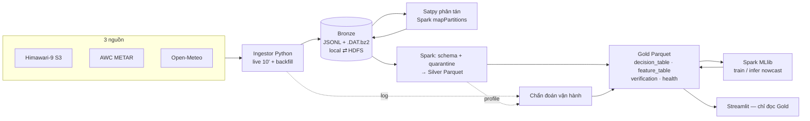

# Kế hoạch: Kiến trúc Big Data và lớp phân tích nâng cao

> Trạng thái: **ĐÃ DUYỆT, ĐÃ TRIỂN KHAI** (2026-11-16). Kết quả và số đo nằm trong `docs/architecture/`.
> Căn cứ: mã nguồn hiện tại, `README.md`, `Big data - Kế hoạch dự án nhóm.md` (bản của nhóm).
> Spec Lark "Big data - Kế hoạch dự án nhóm" (cập nhật 09/11) **chỉ dùng để tham khảo**, không ràng buộc.

## 1. Tổng quan

**Mục tiêu:** khảo sát, đo đạc và đánh giá kiến trúc hiện tại của hệ thống rà soát thời tiết 3 sân bay (VVDN, VVNB, VVTS). Sau đó thiết kế kiến trúc đích, triển khai đầy đủ, và bổ sung lớp phân tích nâng cao gồm chẩn đoán, kiểm định và dự đoán, để hệ thống vận hành đúng mục tiêu nghiệp vụ.

**Phạm vi đã chốt:** đủ các giai đoạn A → E. Tài liệu viết bằng tiếng Việt.

**Ràng buộc:**
- Chỉ dùng 3 nguồn: Himawari-9 (S3 `noaa-himawari9`), METAR của AWC, Open-Meteo. Tải bù dữ liệu lịch sử cũng chỉ lấy từ 3 nguồn này.
- Chạy trên một máy cá nhân. Cụm HDFS chiếm khoảng 1,5 GB RAM cho JVM.
- Quy tắc Mức 1–4 là đáp án chấm KPI. Mô hình dự đoán **chỉ để tham khảo**, không đổi thứ tự ưu tiên.
- Kế hoạch nhóm quy định thay đổi lớn sau buổi 6 cần giảng viên chấp thuận.

### 1.1 Hiện trạng đã kiểm chứng

| Tầng | Hiện trạng | Bằng chứng |
|---|---|---|
| Thu nhận | Daemon Python `run_ingest --loop`: METAR mỗi 10′, Open-Meteo mỗi 60′, Himawari B13 2 phân đoạn mỗi 10′. Ghi nguyên tử, khóa bằng `portalocker` | `src/ingestion/*`, `run_daemon.bat` |
| Bronze | Layout `daily_jsonl`, phân vùng `date=`, shard 64 MiB. **Mỗi batch viết lại nguyên tử chính shard cuối, tên file không đổi** | `data/storage_state.json`, `raw_store.py:283-296` |
| HDFS | 1 NameNode và 1 DataNode `apache/hadoop:3`, `dfs.replication=1`, `permissions.enabled=false`, đồng bộ qua WebHDFS | `config/hadoop/hadoop.env` |
| Thông lượng HDFS | 49 tệp, 16,6 MB, 18,4 s, tức 0,86 MB/s. **Chỉ có một lần đo, chưa tách được nguyên nhân** | `data/logs/hdfs_sync_log.jsonl` |
| Xử lý | PySpark `local[*]`, `shuffle.partitions=4`, chạy batch. Khoảng 2 phút mỗi lần chạy, **tính tổng** cho khởi động JVM và nhiều job, chưa đo riêng từng phần | `src/spark/session.py`, README:119 |
| Ghi kết quả | `.collect()` về driver rồi ghi JSONL bằng `pathlib.Path`. **Không có Parquet ở đâu trong `src/`.** Với storage root `hdfs://`, đầu ra không ghi được lên HDFS | `run_pipeline.py:194-222` |
| Ghép dự báo | Giờ đích là `date_trunc(hour, slot) + 1h`. Ở replay, dự báo `is_backfill` được nhận dù lấy về sau mốc rà soát | `temporal_join.py:96-114` |
| Open-Meteo | Chỉ thu lượng mưa và các giá trị đo (`precipitation, rain, showers, weather_code, visibility, wind_*`), **không có xác suất** | `open_meteo_client.py:43` |
| Quy tắc | `FORECAST_RAIN_ALERT_MM = 0.1`, `LOW_VISIBILITY_M = 5000`, `METAR_STALE_MINUTES = 60` | `priority_rules.py:13-15` |
| Phục vụ | Streamlit đọc thẳng JSONL và PNG | `src/dashboard/*` |
| Dung lượng | `raw` 12 MB, `processed` 3,7 MB, `raw_compact` 1,3 MB | `du` |

### 1.2 Điểm lệch và giả thuyết cần xác nhận ở giai đoạn A
1. Thiếu Parquet, dù bản kế hoạch nhóm ghi đầu ra là "bảng quyết định Parquet".
2. Đầu ra không ghi được lên HDFS (mâu thuẫn với thiết kế Dual-Mode của nhóm).
3. Volume ở mức MB. Lập luận "Big Data" phải dựa vào Variety, Velocity, Veracity và khả năng mở rộng.
4. [GIẢ THUYẾT] Throughput 0,86 MB/s có thể do chi phí cho từng tệp hoặc từng lần gọi WebHDFS. Kiểm chứng ở B6.
5. [GIẢ THUYẾT] Dashboard có thể tự tính mức ưu tiên ở chế độ live (dấu hiệu từ commit `a6373a5`).
6. Replay nhận dự báo backfill lấy về muộn (`temporal_join.py:111-114`), có thể gây rò rỉ dữ liệu tương lai.
7. [CẦN XÁC NHẬN TÀI LIỆU] Lượng mưa theo giờ của Open-Meteo là tổng của giờ liền trước. Nếu đúng, "giờ tới" phủ `(floor(t), floor(t)+1h]`, không phải `(t, t+60′]`.

### 1.3 Thực hành tham khảo từ spec Lark (chủ động áp dụng, không bắt buộc)
- Hiển thị rõ "dự báo khuyết" cho ca lịch sử chưa có dự báo đã lưu. Không lấp bằng Historical Forecast API.
- Đo 24 giờ trước khi tải bù. Giữ bộ mẫu nộp bài nhỏ.
- Bộ test: ca dữ liệu đến trễ, ca bản tin được sửa, mất nguồn rồi chạy lại và đối soát.
- KPI bổ trợ: tỷ lệ dòng đủ bằng chứng và còn mới; tỷ lệ lượt quét đủ phân đoạn; độ trễ trung vị và P95 từ lúc nhận đủ đầu vào đến lúc công bố; mỗi chỉ số kèm mẫu số, khoảng đo, giờ thiếu.
- Lưu riêng thời điểm sự kiện và thời điểm nhận dữ liệu.

## 2. Hướng tiếp cận

- **Dựa trên bằng chứng:** mọi nhận định đều trỏ tới file, dòng mã hoặc log. Tách rõ số đã đo, mục tiêu và giả thuyết.
- **Khung đánh giá:** 5V, ma trận lưu trữ (workload, độ trễ, mở rộng, quản trị, chi phí, căn cứ chốt), các thuộc tính chất lượng (tái lập, chịu lỗi, quan sát được, bảo trì), rubric MIS5007.
- **Kiến trúc đích chọn phương án "nhàm chán":** giữ bộ công nghệ hiện có, tổ chức lại theo Medallion. Sơ đồ C4 vẽ bằng Mermaid, mỗi quyết định có một ADR.

### 2.1 Kiến trúc đích

| ADR | Quyết định |
|---|---|
| 001 | Medallion. Bronze giữ định dạng gốc; Silver và Gold lưu Parquet, phân vùng `date=` |
| 002 | Spark ghi thẳng vào storage root qua một writer chung, chạy được với cả `data/` và `hdfs://namenode:9000/data` (Dual-Mode như thiết kế nhóm). Local là đường mặc định cho test và demo |
| 003 | Spark là nơi duy nhất tính mức ưu tiên. Dashboard chỉ đọc Gold |
| 004 | Mặc định dùng **một SparkSession chạy lâu dài, đọc batch theo lịch** (`run_pipeline --loop`, poll chữ ký Bronze mỗi 15 s). Mỗi chu kỳ commit một phiên bản lake bất biến (`run_id=…` + `_SUCCESS`); không dùng `partitionOverwriteMode=dynamic`, vì chế độ này không ghi `_SUCCESS`. Structured Streaming **chỉ được chọn khi đủ 3 điều kiện**: Bronze bất biến (mỗi lần flush là một file mới), sink `foreachBatch` idempotent khóa theo `batch_id`/`review_slot_utc`, và có test khởi động lại từ checkpoint không mất, không trùng dòng. Lý do: `raw_store.py:296` viết lại cùng shard, nên file source của Spark sẽ bỏ sót bản ghi nối thêm |
| 005 | Không dùng Kafka/Airflow ở quy mô hiện tại. Ghi ngưỡng để xem xét lại (số sân bay, thời gian lưu giữ, số người dùng) |
| 006 | Mô hình dự đoán chỉ để tham khảo. Chỉ hiển thị khi đạt cổng chất lượng; không đổi Mức 1–4 |

### 2.2 Lớp phân tích nâng cao: 3 trụ cột

| Trụ cột | Câu hỏi trả lời | Phương pháp |
|---|---|---|
| 1. Chẩn đoán vận hành | Hệ thống có chạy đúng không? Thiếu dữ liệu do đâu? | SLA độ mới; độ phủ (dự kiến / đủ phân đoạn / xử lý được); phân loại nguyên nhân khoảng thiếu (tệp có trên S3 thì lỗi máy thu, không có thì nguồn thiếu); robust z-score (MAD) trên số byte, số bản ghi, độ trễ; PSI phát hiện trôi; độ trễ P50/P95 từ lúc nhận đủ đầu vào đến lúc công bố; profile theo nguồn |
| 2. Kiểm định quy tắc | Dự báo mưa và thứ tự Mức 1–4 có khớp với những gì xảy ra sau đó không? | Chấm dự báo tất định có ngưỡng bằng bảng 2×2 (hợp đồng chi tiết ở E5); kiểm tra tính đơn điệu của tỷ lệ sự kiện theo mức; độ nhạy ngưỡng |
| 3. Dự báo ngắn hạn 0–60′ | Sân bay có khả năng chuyển lên Mức 1 trong 60′ tới không? | Logistic Regression của MLlib (giải thích được) so với GBTClassifier, có hiệu chỉnh xác suất. Đặc trưng gồm METAR hiện tại, `rain_mm` giờ tới kèm `forecast_missing`, chỉ số B13 Dual-Box, **tốc độ lạnh đi của đỉnh mây** (Δ`inner_bt_min_c` trong 15′/30′, theo Roberts & Rutledge 2003, Mecikalski & Bedka 2006), giờ trong ngày, sân bay |

**Các phương án loại bỏ:** ConvLSTM hoặc optical flow trên ảnh (thiếu dữ liệu và GPU); LSTM chuỗi thời gian (chỉ có vài nghìn mẫu, dễ học thuộc).

**Cổng chất lượng của trụ cột 3:** chia dữ liệu theo thời gian kiểu walk-forward, có khoảng đệm giữa tập huấn luyện và tập kiểm tra. Ngưỡng của mô hình chọn trên tập validation. Mô hình phải thắng persistence, chỉ-Open-Meteo và bộ quy tắc hiện tại về CSI tại cùng điểm vận hành trên tuần cuối giữ riêng. Không đạt thì không hiển thị, và báo cáo nêu kết quả âm tính.

## 3. Các bước chính

**Mức ưu tiên:** P0 bắt buộc, P1 nên có, P2 nâng cao. Nếu thiếu thời gian, dừng được ở cuối P1.

### A — Khảo sát (P0, chỉ đọc)
1. Lần theo luồng đầu–cuối: `run_ingest` → `raw_store`/`hdfs_client` → `readers` → `quarantine` → `transforms` → `temporal_join` → `priority_engine` → `run_pipeline` → `data_loader`. Xác nhận 7 điểm ở mục 1.2.
2. Kiểm kê nhãn: đếm METAR/SPECI có mưa, dông hoặc tầm nhìn dưới 5 km trong dữ liệu hiện có và trong 30 ngày lấy thử từ AWC (API giữ tối đa 30 ngày, mỗi request ≤ 400 bản ghi, ≤ 100 request/phút).
3. Kiểm kê test hiện có cho các ca dữ liệu đến trễ, bản tin được sửa, mất nguồn. Kiểm tra từ điển dữ liệu so với `schemas.py`, và việc lưu riêng thời điểm sự kiện với thời điểm nhận.

### B — Đo đạc (P0)
4. Đo 24 giờ: số byte theo nguồn, số tệp, dung lượng giữ lại, độ phủ, RAM của từng container.
5. **B5:** đo tách riêng thời gian khởi tạo `SparkSession`, từng giai đoạn (đọc, quarantine, join, priority) và thời gian ghi. Chạy `local[1]` và `local[*]`, đọc local và `hdfs://`. Mỗi cấu hình chạy ít nhất 3 lần, báo cáo trung vị.
6. **B6:** HDFS với cùng tổng dung lượng, số tệp 1, 10, 100. Đo cả WebHDFS và ghi native từ Spark, mỗi cấu hình ít nhất 3 lần. Giả thuyết tệp nhỏ chỉ được xác nhận nếu thời gian tăng theo số tệp, không theo số byte.
7. **B8:** thời gian Satpy cho một lượt quét và cho 1 ngày (144 lượt), chạy tuần tự so với `local[*]`.

### C — Đánh giá (P0)
8. Lập bảng 5V có số đo thật, bảng điểm mạnh/điểm yếu/rủi ro theo tầng, ma trận lưu trữ gồm 3 cột: kho tệp cục bộ + Parquet, HDFS Dual-Mode, PostgreSQL, kèm số đo B.

### D — Kiến trúc đích (P0)
9. Sơ đồ C4 cho hiện trạng và kiến trúc đích, ADR-001 đến 006, roadmap 3 nấc: thêm DataNode và tăng replication → Spark standalone cluster → object storage và orchestrator. Mỗi nấc có điều kiện kích hoạt và chi phí. Có bản rút gọn cho 1 slide kiến trúc và 1 slide ma trận.

### E — Triển khai

| # | Gói việc | File chính | Tiêu chí chấp nhận | Mức |
|---|---|---|---|---|
| E1 | Nền dữ liệu Medallion | Tạo `src/spark/writers.py`; sửa `run_pipeline.py`, `data_loader.py` | Silver/Gold ghi Parquet vào `data/` và `hdfs://`; test HDFS tự skip khi NameNode tắt. Test parity JSONL so với Parquet đạt. Giữ bất biến `rows_read == rows_valid_pre_dedup + rows_quarantined`. Mỗi mốc rà soát đúng 3 dòng | P0 |
| E1b | Runner Spark chạy lâu dài (nếu G3 chọn) | Thêm `--loop` vào `run_pipeline.py` | Không khởi tạo lại session giữa các chu kỳ; gọi `unpersist`/`clearCache` sau mỗi chu kỳ; ghi heartbeat vào Gold `health/`. Chạy lại cùng mốc cho ra cùng khóa và giá trị. Dừng rồi khởi động lại không mất, không trùng dòng | P1 |
| E2 | Một nguồn sự thật cho mức ưu tiên | `src/dashboard/data_loader.py` | Dashboard không còn tự tính mức. Test dashboard đạt | P0 |
| E3 | Chẩn đoán vận hành | `src/diagnostics/{health,gap_attribution,anomaly}.py`; Gold `health/`; tab Sức khỏe | Có đủ chỉ số của trụ cột 1, mỗi chỉ số kèm mẫu số, khoảng đo, giờ thiếu. Một khoảng thiếu tạo nhân tạo được phân loại đúng nguyên nhân. Bất thường được gắn cờ | P0 |
| E4 | Tải bù 30 ngày (chỉ làm sau B) | Thêm `--backfill-days` vào `run_ingest`; tạo `src/spark/himawari_batch.py` | METAR tải theo cửa sổ, tuân thủ rate limit, đặt User-Agent riêng. Bản ghi tải bù có `is_backfill`. Dự báo để "khuyết", không lấp. Satpy chạy song song, có ghi throughput. Khối lượng Himawari khoảng 4.320 lượt × 2,5 MB ≈ 10,8 GB [ƯỚC TÍNH] | P1 |
| E5 | Kiểm định quy tắc | `src/analytics/verification.py`; Gold `verification/` | Theo hợp đồng ở bảng dưới | P1 |
| E6 | Bảng đặc trưng và nhãn | `src/ml/{labels,features}.py`; Gold `feature_table/` | Nhãn `y=1` nếu có METAR/SPECI với `observed_at_utc ∈ (t, t+60′]` ghi mưa/dông tại trạm hoặc `visibility_m < 5000`. Mọi đặc trưng thỏa `available_at ≤ t`. Khung của Open-Meteo `(floor(t), floor(t)+1h]` được ghi trong từ điển. Có test rò rỉ tương lai và test tính Δ khi thiếu lượt quét | P2 |
| E7 | Huấn luyện, đánh giá, suy luận | `src/ml/{train,evaluate,infer}.py`; `models/<version>/` lưu model và metadata (cửa sổ dữ liệu, chỉ số, git sha) | **Brier và reliability chỉ dùng cho xác suất của mô hình.** So với baseline tất định bằng CSI, POD, FAR tại cùng điểm vận hành; PR-AUC chỉ báo cáo cho mô hình. Đánh giá tách cửa sổ live (có dự báo) và cửa sổ tải bù (dự báo khuyết). Theo dõi trôi bằng PSI; đánh giá lại khi nhãn đến trễ 60′ | P2 |
| E8 | Tích hợp dashboard | `src/dashboard/views/{decision,health}.py` | Cột "Nguy cơ 0–60′" hiển thị xác suất đã hiệu chỉnh, 3 đặc trưng đóng góp lớn nhất và nhãn "chỉ tham khảo". Thứ tự Mức 1–4 không đổi | P2 |
| E9 | Tài liệu | `docs/architecture/{01-as-is,02-assessment,03-target,04-roadmap}.md`, `docs/architecture/adr/`, README, từ điển dữ liệu | Thành viên khác chạy lại được từ hướng dẫn. Sơ đồ và ADR khớp với mã | P0 |
| E10 | Bộ test thời gian và chịu lỗi | `tests/spark/`, `tests/ingestion/` | Có đủ (bổ sung nếu A thấy còn thiếu): ca dữ liệu đến trễ; ca bản tin được sửa, giữ riêng bản sửa; mất một nguồn rồi chạy lại, đối soát đủ 3 khóa. Nếu A xác nhận điểm 1.2-6 là vi phạm: replay coi dự báo lấy về muộn là "dự báo khuyết", có test hồi quy | P0 |
| E11 | Đóng gói bộ mẫu nộp | `scripts/package_sample.py` | Gồm cửa sổ phát lại đã ghim và bảng Gold. Không chứa dữ liệu tải bù, khóa truy cập hay thông tin tài khoản | P0 |

**Hợp đồng chấm điểm của E5:**

| Thành phần | Định nghĩa |
|---|---|
| Đơn vị chấm | (sân bay, giờ hiệu lực `T`). Chỉ dùng phiên bản dự báo có `forecast_fetched_at_utc ≤` thời điểm phát hành; loại các bản ghi `is_backfill` |
| Sự kiện dự báo | `greatest(precipitation_mm, rain_mm + showers_mm) ≥ 0,1 mm`, đúng công thức Mức 3 |
| Sự kiện quan trắc | Có METAR/SPECI với `observed_at_utc ∈ (T−1h, T]` và `has_precip_or_thunder_at_station = true`. Không tính tầm nhìn thấp |
| Thước đo | Bảng 2×2, POD, FAR, CSI, frequency bias, kèm số sự kiện, mẫu số, khoảng đo. **Không dùng Brier** |
| Độ nhạy | Chấm lại với ngưỡng 0,1 / 0,5 / 1,0 mm để có nhiều điểm POD–POFD |
| Thứ tự các mức | Tỷ lệ sự kiện trong 60′ sau theo từng Mức 1–4, kèm khoảng tin cậy. Kiểm tra đơn điệu Mức 1 ≥ Mức 3 ≥ Mức 4. Mức 2 chỉ báo cáo mô tả |
| Test | Dự báo lấy về sau thời điểm phát hành bị loại; METAR đúng biên `T−1h` không được tính; bản ghi `is_backfill` bị loại |

`precipitation_probability` không được thu ở giai đoạn này. Ghi vào roadmap.

**Các cổng quyết định:**
- **G1 (sau A2):** nếu có dưới khoảng 50 sự kiện dương thì hủy E6–E8; phần dự đoán thu về chỉ báo heuristic tốc độ lạnh đi của đỉnh mây, được kiểm định ở E5.
- **G2 (sau B4 và B8):** nếu Satpy backfill 30 ngày mất quá thời gian cho phép, **thu hẹp khoảng ngày** (30 → 14 → 7 ngày) và **luôn giữ đủ cả hai phân đoạn** `S0410` (VVDN, VVNB) và `S0510` (VVTS), theo `config/airports.json:25-32`. Không dùng phương án chỉ tải `S0410`. Nếu buộc phải dùng, phải đồng thời: (a) gắn trạng thái "B13 không khả dụng" cho VVTS trong cửa sổ đó, không coi là đủ độ phủ; (b) loại VVTS khỏi việc huấn luyện và đánh giá mô hình có đặc trưng vệ tinh; (c) báo cáo riêng độ phủ theo từng sân bay.
- **G3 (sau B5):** nếu thời gian khởi tạo session chiếm phần đáng kể, làm E1b. Streaming không phải mặc định.

## 4. Rủi ro

| Rủi ro | Tác động | Cách giảm |
|---|---|---|
| Thời gian còn lại ngắn so với khối lượng đầy đủ cộng ML | Không kịp bảo vệ | Làm theo P0 → P1 → P2, có cổng G1–G3, dừng được ở cuối P1 |
| Thay đổi lớn sau buổi 6 cần giảng viên chấp thuận | Vi phạm quy định học phần | Xin chấp thuận cho E1, E4, E6–E8 trước khi viết mã |
| Thiếu nhãn: tháng 11 là mùa khô ở miền Bắc và miền Nam, sự kiện chủ yếu ở VVDN [INFERENCE] | Mô hình học thuộc hoặc lệch theo sân bay | Cổng G1, PR-AUC, báo cáo theo từng sân bay, chấp nhận kết quả âm tính |
| Dữ liệu tải bù không có dự báo | Mô hình và kiểm định thiếu đặc trưng | Dùng cờ `forecast_missing`; đánh giá tách cửa sổ live và cửa sổ tải bù; E5 chỉ chấm trên dự báo tự thu |
| Khung "giờ tới" của Open-Meteo khác `(t, t+60′]` | Kiểm định sai; diễn giải Mức 3 sai | Chấm theo `T` với khoảng `(T−1h, T]`; xác nhận nghĩa của trường ở A; ghi rõ trong từ điển và lý do trên dashboard |
| Replay nhận dự báo backfill lấy về muộn | Rò rỉ dữ liệu tương lai | Xác nhận ở A, sửa ở E10, có test hồi quy |
| Spark streaming bỏ sót bản ghi vì Bronze viết lại cùng shard | Thiếu dữ liệu mà không báo lỗi | ADR-004: mặc định đọc batch theo lịch; streaming chỉ dùng khi đủ 3 điều kiện |
| SparkSession chạy lâu dài rò bộ nhớ | Kết quả lệch, tiến trình chết | `unpersist`/`clearCache` mỗi chu kỳ, đọc lại file, heartbeat để E3 phát hiện |
| Mô hình bị hiểu là khuyến nghị khai thác bay | Rủi ro an toàn và học thuật | ADR-006; nhãn "chỉ tham khảo"; không đổi Mức 1–4 |
| Backfill 10,8 GB làm đầy đĩa, Satpy trong worker làm quá tải RAM | Máy thu live bị gián đoạn | B8 trước; xử lý theo lô ngày; dọn `.DAT.bz2` sau khi trích chỉ số; giới hạn số worker |
| Bị rate limit AWC | Bị chặn IP | Chia cửa sổ, đặt User-Agent riêng, tạm dừng giữa request, dùng `http_client` có backoff |
| Chuyển sang Parquet gây hồi quy | Hỏng demo | Chạy song song JSONL một thời gian, có test parity, giữ JSONL làm bản dự phòng ngoại tuyến |
| Bật HDFS cùng Spark làm thiếu RAM | Mất lượt quét | Test HDFS tự skip khi tắt; benchmark ngoài cửa sổ thu |
| Benchmark trên Windows bị nhiễu | Kết luận sai | Chạy lặp lại, ghi cỡ mẫu; mọi nhận định là giả thuyết đến khi có B5/B6/B8 |

## 5. Còn chờ cung cấp
1. Ngày bảo vệ chính xác, để đặt điểm dừng P1/P2.
2. Tình trạng xin giảng viên chấp thuận cho thay đổi sau buổi 6.
