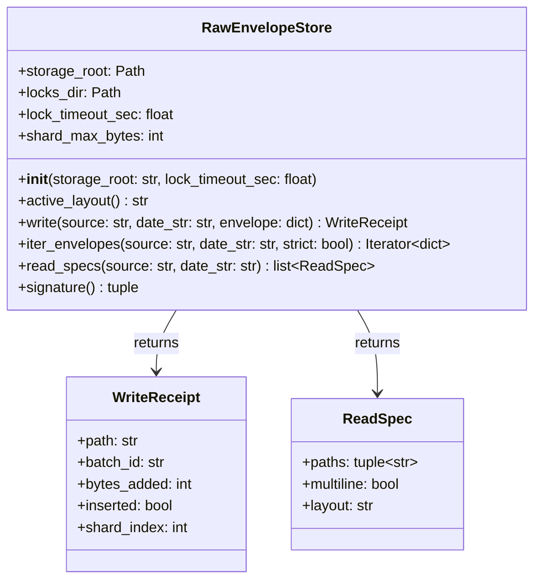
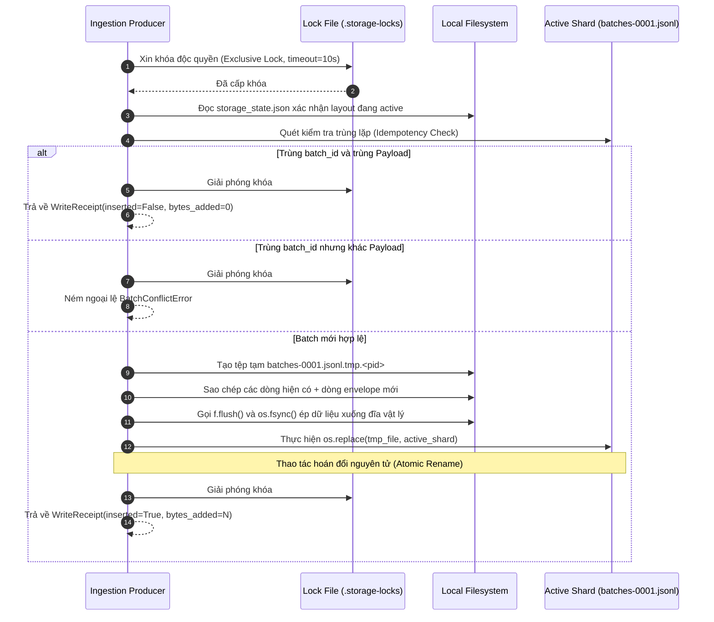
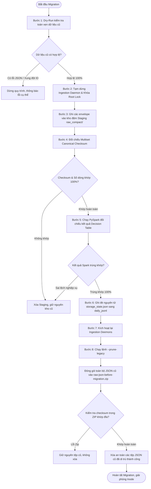

# Tài liệu Thiết kế (Spec) — Kiến trúc Lưu trữ Gộp Bản gốc (Compact Raw Storage) bằng Daily JSONL, Khóa Liên tiến trình và Quy trình Chuyển đổi Dữ liệu

**Ngày tạo:** 2026-11-10  
**Dự án:** Hệ thống hỗ trợ điều phối viên rà soát thời tiết tại ba sân bay Việt Nam (`VVDN`, `VVNB`, `VVTS`)  
**Phạm vi:** Mô-đun Ingestion & Data Lake (Đặc tả kỹ thuật hoàn thiện cho Phần B — Task 7 đến Task 11 trong Kế hoạch `docs/superpowers/plans/2026-11-10-dashboard-review-fixes.md`).  
**Trạng thái:** Thiết kế kỹ thuật chi tiết; sẵn sàng để triển khai mã nguồn mà không ảnh hưởng hay làm gián đoạn kho dữ liệu đang hoạt động.

---

## 1. Mục tiêu, Động lực và Phân tích 5V

### 1.1. Hiện trạng và "Vấn đề Tệp Nhỏ" (Small Files Problem)
Kho lưu trữ hiện tại đang tổ chức dữ liệu thu thập từ các API khí tượng theo cơ chế **Mỗi lượt gọi API = Một tệp JSON riêng biệt** (Hive partition: `data/raw/<source>/date=YYYY-MM-DD/<filename>.json`).
Khảo sát thực tế thư mục tại thời điểm thiết kế:
- **METAR:** 27 tệp JSON.
- **Open-Meteo:** 36 tệp JSON (3 sân bay độc lập mỗi giờ).
- **Himawari metrics:** 11 tệp JSON (trích xuất chỉ số đỉnh mây từ vệ tinh).
- **Tổng cộng:** 74 tệp JSON dạng envelope, nhưng tổng dung lượng thực tế chỉ vỏn vẹn **0.63 MiB** (~8.7 KiB/tệp).
*(Lưu ý: Dữ liệu nhị phân vệ tinh HSD có 19 tệp ~51.7 MiB và ảnh PNG có 27 tệp ~2.6 MiB thuộc nhóm dữ liệu phi cấu trúc riêng, được quản lý theo vòng đời riêng).*

Theo tần suất thu thập tự động (daemon 24/7):
- METAR: 10 phút/lần = 144 batch/ngày.
- Open-Meteo: 1 giờ/lần cho 3 sân bay (`VVDN`, `VVNB`, `VVTS`) = 72 batch/ngày.
- Himawari metrics: 10 phút/lần (khi bật xử lý vệ tinh) = 144 batch/ngày.
- **Tổng phát sinh dự kiến:** Khoảng **360 tệp JSON/ngày** trong điều kiện bình thường. Sau 7 ngày là ~2,520 tệp, sau 30 ngày là ~10,800 tệp.

**Hậu quả kỹ thuật:**
1. **Quá tải Inode & Filesystem Metadata:** Trên hệ điều hành máy trạm (Windows NTFS) cũng như trên Docker bind-mount, việc liệt kê hàng nghìn tệp nhỏ gây suy giảm hiệu năng I/O đáng kể (`glob` thư mục chậm, tốn CPU).
2. **Quá tải Hadoop HDFS NameNode:** Trên cụm HDFS đơn nốt (`apache/hadoop:3`), mỗi tệp (dù chỉ vài KiB) đều chiếm khoảng 150 byte metadata trong RAM của NameNode. Hàng vạn tệp nhỏ gây lãng phí bộ nhớ JVM và làm chậm quá trình quét khối (Block scanning).
3. **Phân mảnh PySpark Tasks:** PySpark mặc định gán task xử lý theo phân vùng tệp. Quá nhiều tệp nhỏ dẫn đến overhead khởi tạo task lớn hơn nhiều so với thời gian tính toán thực tế (Scheduling Overhead >> Execution Time).

### 1.2. Mục tiêu Thiết kế
1. **Giảm số lượng tệp vật lý:** Gom toàn bộ các batch trong cùng một ngày UTC của một nguồn dữ liệu vào duy nhất một tệp định dạng **JSON Lines (JSONL)**, hỗ trợ tự động chia shard khi dung lượng vượt ngưỡng an toàn (64 MiB).
2. **Hiệu quả định lượng:** Giảm từ **360 tệp/ngày xuống còn 3 tệp/ngày** (giảm **99.17%** số tệp phát sinh hàng ngày trong điều kiện lý tưởng chưa tràn shard).
3. **Bảo toàn 100% dữ liệu và khả năng truy nguyên (Full Provenance & Idempotency):** Giữ nguyên vẹn toàn bộ cấu trúc envelope hiện tại (`metadata` + `payload`), nhãn phiên bản dự báo (`fetched_at_utc`), giờ quan trắc, mã batch (`batch_id`) và nhãn backfill. Không làm mất bất kỳ bản ghi nào phục vụ replay hoặc quarantine.
4. **Tương thích hoàn toàn với PySpark & Streamlit:** PySpark đọc trực tiếp file JSONL với `multiLine=False`; Streamlit Dashboard đọc nhanh thông qua iterator mà không phải glob hàng nghìn tệp; logic nghiệp vụ phân loại ưu tiên sân bay (Priority Engine) giữ nguyên tính đẳng thức 100%.
5. **An toàn chuyển đổi (Zero Downtime / Zero Data Loss Migration):** Cung cấp công cụ migration có kiểm chứng đối soát multiset checksum, backup tự động dạng ZIP và cơ chế rollback an toàn tuyệt đối.

### 1.3. Đánh giá theo Mô hình 5V của Big Data
- **Volume:** Dung lượng lưu trữ thực tế hầu như không đổi (~0.63 MiB cho 74 batch ban đầu), nhưng chi phí lưu trữ metadata hệ thống và dung lượng tải qua mạng HDFS giảm rõ rệt.
- **Velocity:** Xử lý ghi dòng trực tiếp theo nhịp thu thập 10 phút (METAR), 60 phút (Open-Meteo). Cơ chế khóa file đảm bảo độ trễ ghi cực thấp (< 50ms).
- **Variety:** Hợp nhất các bản tin bán cấu trúc (JSON API) vào luồng JSONL chuẩn hóa, tách biệt rõ ràng với dữ liệu nhị phân vệ tinh (`.DAT.bz2`) và dữ liệu ảnh (`.png`).
- **Veracity:** Duy trì tính bất biến (immutability) của từng envelope. Ngăn chặn triệt để tình trạng ghi đè sai lệch hoặc ghi dở dang khi gặp sự cố phần cứng/mạng.
- **Value:** Rút ngắn thời gian quét dữ liệu và khởi động dashboard từ hàng chục giây xuống dưới 1 giây, hỗ trợ điều phối viên rà soát thời tiết tức thì.

---

## 2. So sánh và Lựa chọn Giải pháp Kiến trúc

| Tiêu chí | Phương án 1: Daily JSONL với Phân mảnh Shard (ĐƯỢC CHỌN) | Phương án 2: SQLite nhúng (`sqlite3`) | Phương án 3: Cơ sở dữ liệu quan hệ (PostgreSQL) |
| :--- | :--- | :--- | :--- |
| **Phù hợp kiến trúc Data Lake & Spark** | **Rất cao:** PySpark hỗ trợ gốc đọc JSONL theo lô (`multiLine=False`) với thông lượng đọc tuần tự tối đa; tương thích trực tiếp với HDFS WebHDFS. | **Thấp:** Cần driver JDBC và chuyển đổi qua lại giữa SQL và Spark DataFrame; Spark không tận dụng được tính phân tán trên SQLite. | **Trung bình:** PySpark đọc qua JDBC cần cấu hình connection pool và phân vùng query; overhead mạng nội bộ cao. |
| **Độ phức tạp vận hành** | **Rất thấp:** Chỉ là các tệp văn bản UTF-8 trên đĩa, không cần cài đặt thêm server hay daemon dịch vụ. | **Thấp:** Không cần server, chỉ là 1 tệp `.db`, nhưng dễ xung đột khóa khi nhiều process cùng ghi trên Docker bind mount. | **Cao:** Cần duy trì một container PostgreSQL riêng, cấu hình volume, bảo trì cơ sở dữ liệu và quản lý kết nối. |
| **Bảo vệ ghi đồng thời** | **Tốt:** Sử dụng khóa file cấp hệ điều hành qua `portalocker` (`exclusive lock`), ghi qua tệp tạm rồi hoán đổi nguyên tử (`os.replace`). | **Tốt:** SQLite có cơ chế khóa WAL (Write-Ahead Logging), nhưng dễ gặp lỗi `database is locked` trên file hệ thống mount từ Windows vào Docker. | **Rất tốt:** Hệ quản trị cơ sở dữ liệu hỗ trợ giao dịch ACID đa tiến trình mạnh mẽ. |
| **Khả năng khôi phục & Debug** | **Cực kỳ trực quan:** Có thể xem, sửa lỗi hoặc khôi phục từng dòng bằng công cụ dòng lệnh tiêu chuẩn (`head`, `tail`, `grep`, VS Code). | **Trung bình:** Phải dùng SQLite CLI hoặc DBeaver để kiểm tra bảng và schema. | **Trung bình:** Cần kết nối psql hoặc công cụ quản trị cơ sở dữ liệu. |
| **Khả năng đồng bộ HDFS** | **Tự nhiên:** Đẩy nguyên tệp JSONL lên HDFS theo cấu trúc phân vùng `date=YYYY-MM-DD`. | **Khó:** Phải dump bảng ra file trung gian trước khi đồng bộ lên HDFS. | **Khó:** Cần công cụ CDC (Debezium/Sqoop) để đẩy dữ liệu bảng sang Data Lake. |
| **Đánh đổi chính** | Phép ghi tệp theo cơ chế snapshot rewrite cần đọc và ghi lại toàn bộ shard hiện tại (tối đa 64 MiB); tra cứu lịch sử cần đọc tuần tự. | Phải quản lý schema migration, tệp nhị phân dễ lỗi khi crash giữa chừng và không tương thích HDFS. | Tốn thêm RAM (~300–500 MiB), CPU và công bảo trì vượt quá phạm vi dự án máy trạm cá nhân. |

**Quyết định kỹ thuật:** Chọn **Phương án 1 (Daily JSONL)** vì duy trì tính liên tục và triết lý lưu trữ dạng tệp phân tán của Big Data, tương thích hoàn hảo với Hadoop HDFS và PySpark trong chương trình môn học, đồng thời giải quyết triệt để vấn đề tệp nhỏ mà không phát sinh thêm dịch vụ nền.

---

## 3. Kiến trúc Lưu trữ và Bố cục Dữ liệu

### 3.1. Sơ đồ Tổng thể Bố cục Thư mục

```text
DLL/
├── data/
│   ├── storage_state.json                 # Tệp quản lý trạng thái kho: schema_version, active layout
│   ├── .storage-locks/                    # Thư mục chứa các tệp khóa liên tiến trình (portalocker)
│   │   └── raw_store.lock
│   ├── raw/                               # Kho cũ (Legacy layout) và dữ liệu nhị phân vệ tinh
│   │   ├── metar/date=YYYY-MM-DD/*.json   # (Chuyển thành read-only khi compact active, xóa sau prune)
│   │   ├── open_meteo/date=YYYY-MM-DD/*.json
│   │   ├── himawari_metrics/date=YYYY-MM-DD/*.json
│   │   ├── himawari_hsd/date=YYYY-MM-DD/  # Giữ nguyên: tệp gốc vệ tinh .DAT.bz2 (quản lý retention 24h)
│   │   └── synthetic_quarantine/          # Giữ nguyên: kịch bản kiểm thử lỗi schema
│   ├── raw_compact/                       # Kho mới (Compact layout)
│   │   ├── metar/
│   │   │   └── date=2026-11-10/
│   │   │       ├── batches-0001.jsonl     # Chứa 144 dòng envelope METAR trong ngày
│   │   │       └── batches-0002.jsonl     # (Tự động tạo nếu shard 0001 vượt quá 64 MiB)
│   │   ├── open_meteo/
│   │   │   └── date=2026-11-10/
│   │   │       └── batches-0001.jsonl     # Chứa 72 dòng envelope của cả 3 sân bay trong ngày
│   │   └── himawari_metrics/
│   │       └── date=2026-11-10/
│   │           └── batches-0001.jsonl     # Chứa 144 dòng envelope trích xuất chỉ số đỉnh mây
│   ├── backups/
│   │   └── raw-json-before-migration.zip  # Bản sao lưu nén toàn bộ tệp JSON cũ trước khi prune
│   ├── processed/                         # Bảng quyết định Parquet, chỉ số trích xuất và ảnh cắt PNG
│   │   ├── decision_table.parquet/
│   │   └── himawari_b13/
│   └── logs/
│       ├── ingestion_log.jsonl            # Nhật ký thu thập dữ liệu (tiếp tục cơ chế JSONL)
│       ├── hdfs_sync_log.jsonl            # Nhật ký đo lường thông lượng WebHDFS
│       ├── hdfs_sync_manifest.json        # Bản đồ băm SHA-256 để bỏ qua tệp HDFS không đổi
│       └── migration_report_*.json        # Báo cáo kiểm chứng chi tiết các đợt migration
```

### 3.2. Cấu trúc Quản lý Trạng thái Kho (`storage_state.json`)
Tệp `data/storage_state.json` đóng vai trò là "Single Source of Truth" quy định layout đang hoạt động của hệ thống lưu trữ:

```json
{
  "schema_version": 1,
  "raw_layout": "daily_jsonl",
  "updated_at_utc": "2026-11-10T03:00:00Z",
  "active_sources": [
    "metar",
    "open_meteo",
    "himawari_metrics"
  ],
  "shard_max_bytes": 67108864,
  "comment": "Switch to daily_jsonl after successful verification of multiset parity."
}
```

**Quy tắc xác định trạng thái (Layout Discovery Rules):**
1. **Trường hợp có tệp `storage_state.json`:**
   - Nếu `raw_layout == "daily_jsonl"`: Hệ thống chỉ đọc và ghi vào `data/raw_compact/`.
   - Nếu `raw_layout == "legacy_files"`: Hệ thống chỉ đọc và ghi vào `data/raw/`.
   - Nếu giá trị `raw_layout` bất hợp lệ hoặc tệp JSON bị hỏng (malformed): Ném ngoại lệ `CorruptStorageStateError`, dừng ngay lập tức. Tuyệt đối không tự ý đoán layout để tránh đọc sai lệch kho dữ liệu.
2. **Trường hợp chưa có tệp `storage_state.json`:**
   - Nếu thư mục `data/raw/` tồn tại và có chứa ít nhất một tệp `.json` thuộc các nguồn trên: Tự động hiểu là `legacy_files` (chế độ tương thích ngược).
   - Nếu thư mục `data/` hoàn toàn mới hoặc chưa có dữ liệu: Tự động khởi tạo `storage_state.json` với `raw_layout = "daily_jsonl"`.
3. **Nguyên tắc cô lập tuyệt đối (Layout Isolation Invariant):**
   - Tại mọi thời điểm, hệ thống chỉ chấp nhận duy nhất một layout đang `active`.
   - Các tầng đọc (PySpark, Streamlit Loader) **không bao giờ thực hiện union** giữa `raw/` và `raw_compact/`. Điều này loại bỏ triệt để nguy cơ nhân đôi dữ liệu (Double Counting).

---

## 4. Định dạng Bản tin và Quy chuẩn Dữ liệu JSONL

### 4.1. Quy chuẩn Dòng (Line Formatting Standards)
- **Định dạng mã hóa:** UTF-8 chuẩn xác, không có BOM (Byte Order Mark).
- **Phân cách dòng:** Ký tự xuống dòng chuẩn Unix `\n` (`0x0A`).
- **Quy tắc toàn vẹn:** Mỗi dòng là một đối tượng JSON hợp lệ duy nhất, tự đóng kín (self-contained), không chứa ký tự xuống dòng bên trong các trường chuỗi (mọi ký tự xuống dòng nội dung phải được escape dạng `\n`).
- Không có khoảng trắng thừa ở đầu hoặc cuối dòng.

### 4.2. Cấu trúc Envelope Đầy đủ
Cấu trúc envelope không thay đổi bất kỳ trường nào so với quy chuẩn đã thiết kế ở Mô-đun 1, đảm bảo tính kế thừa hoàn hảo cho PySpark:

```json
{
  "metadata": {
    "batch_id": "20261110T080000Z_metar_a1b2c3",
    "source": "aviationweather_metar",
    "source_url": "https://aviationweather.gov/api/data/metar?ids=VVDN%2CVVNB%2CVVTS&format=json&hours=2",
    "attribution": "NOAA/NWS Aviation Weather Center (https://aviationweather.gov/data/api/)",
    "expected_slot_utc": "2026-11-10T08:00:00Z",
    "fetched_at_utc": "2026-11-10T08:01:15Z",
    "is_backfill": false,
    "http_status": 200,
    "airport_icao": null
  },
  "payload": [
    {
      "metar_id": 1234567,
      "icaoId": "VVDN",
      "receiptTime": "2026-11-10 08:00:30",
      "obsTime": 1794297600,
      "reportTime": "2026-11-10T08:00:00Z",
      "temp": 28.0,
      "dewp": 24.0,
      "wdir": 90,
      "wspd": 12,
      "wgst": null,
      "visib": "10+",
      "altim": 1012.0,
      "slp": null,
      "qcField": 0,
      "wxString": "-RA",
      "presTend": null,
      "maxT": null,
      "minT": null,
      "maxT24": null,
      "minT24": null,
      "precip": null,
      "pcp3hr": null,
      "pcp6hr": null,
      "pcp24hr": null,
      "snow": null,
      "vertVis": null,
      "metarType": "METAR",
      "rawOb": "METAR VVDN 100800Z 09012KT 9999 -RA FEW018 BKN030 28/24 Q1012 NOSIG"
    }
  ]
}
```

*Ghi chú riêng cho Open-Meteo:* Đối với nguồn `open_meteo`, 3 sân bay (`VVDN`, `VVNB`, `VVTS`) được lưu chung vào cùng một tệp `batches-0001.jsonl` của ngày đó. Khác biệt giữa các dòng nằm ở trường `metadata.airport_icao` (tương ứng là `"VVDN"`, `"VVNB"`, hoặc `"VVTS"`).

### 4.3. Quy tắc Phân vùng (Partitioning) và Chia Shard (Sharding)
1. **Phân vùng Ngày UTC (`date=YYYY-MM-DD`):** Luôn lấy theo nhãn thời gian UTC được truyền từ Ingestion (`date_str`), tuyệt đối không sử dụng múi giờ địa phương máy trạm để tránh xáo trộn mốc thời gian lúc chuyển giao ngày (00:00 UTC = 07:00 ICT).
2. **Quy tắc Đặt tên Tệp Shard:** `batches-{index:04d}.jsonl` (bắt đầu từ `batches-0001.jsonl`).
3. **Ngưỡng Phân mảnh (Shard Threshold):** Mặc định là `64 * 1024 * 1024` bytes (**64 MiB**).
   - Trước khi ghi một envelope mới, store kiểm tra kích thước hiện tại của shard.
   - Nếu `kích_thước_hiện_tại + dung_lượng_dòng_mới > 64 MiB`: Tiến hành tạo shard mới `batches-0002.jsonl`.
   - **Bảo toàn tính nguyên vẹn của dòng:** Nếu một envelope đơn lẻ có dung lượng vượt quá 64 MiB (trường hợp cực hiếm), envelope đó vẫn được ghi trọn vẹn vào một shard riêng biệt, **tuyệt đối không cắt ngang dòng**.

---

## 5. Thiết kế Module Lưu trữ Chung (`src/ingestion/raw_store.py`)

Module `raw_store.py` đóng vai trò là lớp trừu tượng duy nhất (Data Access Layer) chịu trách nhiệm về toàn bộ thao tác đọc/ghi dữ liệu thô. Không một module nào khác trong hệ thống (Ingestor, PySpark, Dashboard, Migration) được phép tự ý sử dụng `pathlib.glob("*.json")` để quét dữ liệu.



### 5.1. Định nghĩa Data Classes và Exceptions

```python
from dataclasses import dataclass
from typing import Any, Dict, Iterator, List, Optional, Tuple


class RawStoreError(Exception):
    """Ngoại lệ cơ sở cho mọi lỗi phát sinh từ RawEnvelopeStore."""
    pass


class LockTimeoutError(RawStoreError):
    """Ném ra khi không thể chiếm được file lock trong khoảng thời gian quy định."""
    pass


class BatchConflictError(RawStoreError):
    """Ném ra khi batch_id đã tồn tại nhưng nội dung payload mới lại khác với payload đã lưu."""
    pass


class CorruptStorageStateError(RawStoreError):
    """Ném ra khi storage_state.json bị thiếu, định dạng sai hoặc layout không hợp lệ."""
    pass


class CorruptShardError(RawStoreError):
    """Ném ra khi phát hiện dòng JSONL bị hỏng trong chế độ strict=True."""
    pass


@dataclass(frozen=True)
class WriteReceipt:
    path: str              # Đường dẫn tệp shard đã ghi (ví dụ: data/raw_compact/metar/date=2026-11-10/batches-0001.jsonl)
    batch_id: str          # Mã định danh lô dữ liệu
    bytes_added: int       # Số byte thực tế được bổ sung (bao gồm ký tự \n)
    inserted: bool         # True nếu bản ghi mới được thêm; False nếu là retry trùng lặp hợp lệ (no-op)
    shard_index: int       # Thứ tự phân mảnh (ví dụ: 1 ứng với batches-0001.jsonl)


@dataclass(frozen=True)
class ReadSpec:
    paths: Tuple[str, ...] # Danh sách các đường dẫn tệp cần đọc
    multiline: bool        # True với kho cũ (JSON), False với kho mới (JSONL)
    layout: str            # "legacy_files" hoặc "daily_jsonl"
```

### 5.2. Chi tiết Hợp đồng Giao diện (Interface Contract)

```python
class RawEnvelopeStore:
    def __init__(
        self,
        storage_root: str = "data",
        lock_timeout_sec: float = 10.0,
        shard_max_bytes: int = 64 * 1024 * 1024,
    ) -> None:
        """
        Khởi tạo kho lưu trữ.
        - storage_root: Thư mục gốc chứa data/.
        - lock_timeout_sec: Thời gian chờ tối đa khi xin khóa độc quyền (mặc định 10.0 giây).
        - shard_max_bytes: Ngưỡng kích thước tối đa của mỗi tệp shard JSONL (mặc định 64 MiB).
        """
        ...

    def active_layout(self) -> str:
        """
        Trả về layout hiện tại: "legacy_files" hoặc "daily_jsonl".
        Đọc và xác thực từ storage_state.json; ném CorruptStorageStateError nếu file lỗi.
        """
        ...

    def write(
        self,
        source: str,
        date_str: str,
        envelope: Dict[str, Any],
    ) -> WriteReceipt:
        """
        Ghi một envelope mới vào kho lưu trữ một cách an toàn và nguyên tử.
        
        Quy tắc:
        1. source chỉ chấp nhận: 'metar', 'open_meteo', 'himawari_metrics'.
        2. batch_id là bắt buộc trong metadata.
        3. Chiếm exclusive lock trên storage_root thông qua portalocker.
        4. Kiểm tra trùng lặp (Idempotency):
           - Nếu batch_id đã có trong partition date_str và payload giống hệt:
             Trả về WriteReceipt(inserted=False, bytes_added=0).
           - Nếu batch_id đã có nhưng payload khác biệt:
             Ném BatchConflictError để ngăn ngừa ghi đè dữ liệu sai lệch.
        5. Xác định shard thích hợp (batches-XXXX.jsonl). Nếu shard hiện tại đầy, tạo shard mới.
        6. Cơ chế Snapshot Rewrite nguyên tử:
           - Ghi toàn bộ nội dung sang tệp tạm: <shard>.tmp.<pid>
           - Thực hiện flush() và os.fsync().
           - Hoán đổi an toàn bằng os.replace().
        7. Giải phóng lock và trả về WriteReceipt.
        """
        ...

    def iter_envelopes(
        self,
        source: str,
        *,
        date_str: Optional[str] = None,
        strict: bool = True,
    ) -> Iterator[Dict[str, Any]]:
        """
        Duyệt tuần tự qua các envelope của một nguồn theo layout đang active.
        
        - Nếu date_str được truyền: chỉ đọc partition date=<date_str>.
        - Nếu date_str=None: duyệt qua toàn bộ các partition ngày.
        - strict=True (dùng cho Migration & PySpark parity test):
          Nếu gặp dòng JSONL bị hỏng cú pháp, lập tức ném CorruptShardError.
        - strict=False (dùng cho Dashboard & Live View):
          Bỏ qua dòng bị hỏng, ghi log cảnh báo chi tiết đường dẫn và số dòng,
          tiếp tục đọc các dòng hợp lệ còn lại mà không làm sập ứng dụng.
        """
        ...

    def read_specs(
        self,
        source: str,
        date_str: Optional[str] = None,
    ) -> List[ReadSpec]:
        """
        Trả về đặc tả đường dẫn và cấu hình đọc cho PySpark hoặc các engine bên ngoài.
        Tự động xác định cờ multiline tương ứng với layout đang active:
        - "daily_jsonl" -> multiline=False
        - "legacy_files" -> multiline=True
        """
        ...

    def signature(self) -> Tuple[Tuple[str, int, int], ...]:
        """
        Tính toán chữ ký trạng thái (State Signature) của kho dữ liệu phục vụ
        cơ chế Invalidation Cache (Task 3 và Task 9 trong Kế hoạch kiểm thử).
        
        Chữ ký gồm danh sách đã sắp xếp các bộ 3 phần tử:
        (đường_dẫn_tương_đối, dung_lượng_byte, mtime_ns)
        bao gồm: tệp storage_state.json và toàn bộ các tệp shard đang active.
        
        Khi có batch mới append vào shard cũ, dung lượng và mtime_ns thay đổi -> signature thay đổi ->
        Dashboard tự động nhận diện nguồn mới và làm mới mốc LIVE tức thì.
        """
        ...
```

---

## 6. Cơ chế Ghi Đồng thời, Khóa Liên tiến trình và Tính Nguyên tử

### 6.1. Thư viện Khóa Liên tiến trình (`portalocker`)
Trong môi trường vận hành thực tế, có nhiều tiến trình chạy song song:
- Daemon thu thập METAR (mỗi 10 phút).
- Daemon thu thập Open-Meteo (mỗi 60 phút).
- Daemon vệ tinh Himawari metrics (mỗi 10 phút).
- Tác vụ người dùng nhấn nút "Cập nhật LIVE" trên Streamlit UI.
- Tiến trình chạy Migration chuyển đổi kho.

Để ngăn chặn hiện tượng tranh chấp ghi (Race Condition), hệ thống sử dụng thư viện **`portalocker>=3.2,<5`**:
- **Cơ chế:** Khóa tệp ở cấp độ nhân hệ điều hành (`msvcrt.locking` trên Windows; `fcntl.flock` trên Linux/macOS).
- **Vị trí tệp khóa:** Cố định tại `data/.storage-locks/raw_store.lock`.
- **Loại khóa:** Khóa độc quyền (`portalocker.Lock(..., flags=portalocker.LOCK_EX)`).
- **Thời gian chờ (Timeout):** Mặc định 10.0 giây. Nếu quá 10 giây không lấy được khóa, tiến trình báo lỗi `LockTimeoutError`, tuyệt đối không ghi đè bừa bãi và không ghi log nhận nhầm trạng thái `SUCCESS`.

### 6.2. Quy trình Ghi Nguyên tử (Atomic Snapshot-Rewrite Flow)
Thay vì sử dụng thao tác append trực tiếp vào tệp đang mở (vốn dễ khiến tiến trình đọc Streamlit hoặc PySpark đọc phải dòng JSON bị cắt dở khi đang ghi), hệ thống áp dụng chiến lược **Ghi lại Snapshot qua tệp tạm**:



**Xử lý đặc thù trên Hệ điều hành Windows:**
Trên Windows, tệp đang được mở bởi một tiến trình đọc (như Streamlit data loader hoặc antivirus scanner) có thể khiến lệnh `os.replace` tạm thời ném lỗi `PermissionError` hoặc `FileExistsError`.  
Store cài đặt cơ chế **Retry Backoff nội bộ** trong cửa sổ thời gian của lock (tối đa 10 lần thử, mỗi lần cách nhau 0.1s đến 0.5s). Nếu sau thời gian chờ vẫn bị giữ handle, ném ngoại lệ rõ ràng và giữ nguyên vẹn tệp cũ, **tuyệt đối không dùng `os.unlink` để ép xóa tệp đích**.

---

## 7. Tích hợp Nhà sản xuất Dữ liệu (Producers) và Sửa đổi Nhật ký Đối soát

### 7.1. Cập nhật các Ingestion Clients
Các hàm thu thập dữ liệu trong `src/ingestion/`:
- `metar_client.py` (`fetch_and_save_metar`)
- `open_meteo_client.py` (`fetch_and_save_open_meteo`)
- `satpy_processor.py` (bước xuất chỉ số `himawari_metrics`)

Được chuyển đổi từ việc gọi hàm cũ `save_raw_envelope` sang `RawEnvelopeStore.write(...)`:

```python
# Ví dụ triển khai chuẩn trong metar_client.py
store = RawEnvelopeStore(base_dir=base_dir)
receipt = store.write(
    source="metar",
    date_str=date_str,
    envelope=envelope
)
```

### 7.2. Chuẩn hóa Trường `bytes_written` trong `ingestion_log.jsonl`
**Lỗi tiềm ẩn nghiêm trọng cần tránh:** Nếu lấy `os.path.getsize(receipt.path)` để ghi vào nhật ký kiểm toán, trường `bytes_written` của batch thứ 144 trong ngày sẽ bị tính bằng tổng dung lượng của toàn bộ 144 batch cộng lại, làm sai lệch hoàn toàn thống kê dung lượng tải về của hệ thống (phồng ảo số liệu Volume trong 5V).

**Quy tắc bất biến đối soát:**
- `bytes_written = receipt.bytes_added`: Chỉ ghi nhận chính xác số byte UTF-8 của riêng envelope vừa thu thập (bao gồm cả ký tự `\n`).
- `file_path = receipt.path`: Ghi nhận đường dẫn tệp container shard chứa bản ghi.
- `storage_layout = "daily_jsonl"`: Đánh dấu rõ ràng layout đang phục vụ ghi dữ liệu.
- `batch_id`: Giữ nguyên mã truy nguyên gốc để đối soát chéo.

---

## 8. Tích hợp PySpark, Dashboard Consumers và Đồng bộ HDFS

### 8.1. Cập nhật PySpark Readers (`src/spark/readers.py`)
Hàm `read_raw_metar`, `read_raw_open_meteo`, và `read_raw_himawari_metrics` được cập nhật tham số keyword-only `multiline: bool = True`. Mặc định `True` giữ tương thích ngược cho các lời gọi cũ đọc JSON nhiều dòng; caller đọc layout `daily_jsonl` luôn truyền `multiline` theo `ReadSpec.multiline` (`False` cho JSONL):

```python
def read_raw_metar(
    spark: SparkSession,
    path: str | list[str],
    *,
    multiline: bool = True
) -> DataFrame:
    files = _resolve_paths(path)
    raw_df = (
        spark.read.schema(METAR_ENVELOPE_SCHEMA)
        .option("multiLine", multiline)
        .option("mode", "PERMISSIVE")
        .option("columnNameOfCorruptRecord", "_corrupt_record")
        .json(files)
        .withColumn("input_file_path", F.input_file_name())
    )
    ...
```

**Tính năng nổi bật của định dạng JSONL trong Spark:**
- Khi `multiLine=False`, PySpark có thể chia nhỏ một tệp JSONL lớn để phân bổ cho nhiều worker đọc song song theo byte offset (Splittable Input).
- Chế độ `PERMISSIVE` kết hợp cột `_corrupt_record`: Nếu trong tệp shard có 1 dòng bị lỗi cú pháp JSON do đường truyền hỏng, PySpark chỉ ghi nhận dòng đó vào bảng Quarantine (`_corrupt_record is not null`), toàn bộ 143 dòng envelope còn lại trong ngày **vẫn được xử lý bình thường mà không bị mất dữ liệu**.

### 8.2. Cập nhật Streamlit Data Loader (`src/dashboard/data_loader.py`)
- Thay thế hoàn toàn các vòng lặp quét đĩa `root.glob("raw/metar/date=*/*.json")` bằng lời gọi `RawEnvelopeStore.iter_envelopes(source="metar", strict=False)`.
- **Khám phá Mốc Mới Nhất (Latest Slot Discovery):** Trước đây hệ thống dựa vào việc sắp xếp tên tệp JSON cũ. Với cấu trúc mới, hệ thống tìm mốc mới nhất bằng cách đọc trường `metadata.fetched_at_utc` hoặc `metadata.expected_slot_utc` trực tiếp từ các envelope được duyệt qua.
- **Tương thích Invalidation Cache (Task 3):** Hàm `_raw_input_signature()` trong `data_loader.py` ủy quyền trực tiếp cho `RawEnvelopeStore.signature()`. Bất kỳ thao tác append nào vào tệp ngày đều làm thay đổi `mtime_ns` và kích thước tệp, kích hoạt hàm sync tính lại bảng quyết định Live tức thì.

### 8.3. Đồng bộ Hadoop HDFS WebHDFS (`src/ingestion/hdfs_client.py`)
Hệ thống Hadoop HDFS hoạt động theo mô hình Dual-Mode phân tán. Việc chuyển đổi sang Daily JSONL mang lại lợi ích to lớn cho HDFS, đồng thời đặt ra 3 yêu cầu kiểm soát chặt chẽ:

1. **Kiến trúc Zero-Lock Network I/O:**
   - Hoạt động tải tệp qua mạng WebHDFS có thể kéo dài nhiều giây nếu mạng chậm.
   - **Giải pháp:** Tiến trình đồng bộ tạo một bản sao snapshot tạm thời dưới quyền giữ lock của `RawEnvelopeStore` (chỉ mất vài mili-giây), giải phóng ngay lock của store, sau đó mới thực hiện upload HTTP stream lên DataNode. Nhờ đó, việc upload mạng không bao giờ làm nghẽn tiến trình thu thập dữ liệu (Ingestion daemon). Xóa snapshot tạm ngay sau khi hoàn thành.
2. **Loại bỏ Tải trùng lặp bằng Manifest (`hdfs_sync_manifest.json`):**
   - Duy trì tệp `data/logs/hdfs_sync_manifest.json` lưu cặp `(hdfs_destination, relative_path) -> sha256_hash`.
   - Lần đồng bộ thứ hai chỉ tải lên các tệp có nội dung thay đổi thực sự; các tệp nguyên vẹn được ghi nhận vào `files_skipped_unchanged` với thời gian thực hiện bằng 0.
   - **Loại trừ tệp rác:** Không bao giờ upload tệp khóa `.storage-locks`, tệp tóm tắt di trú `migration_report_*.json`, hay tệp ZIP sao lưu vào thư mục phân tích của HDFS.
3. **Cơ chế Chuyển đổi Marker Từ xa (Remote Marker Cutover):**
   - Trên HDFS duy trì `hdfs:///data/storage_state.json`.
   - Chỉ khi nào **toàn bộ 100% các tệp shard trong đợt chuyển đổi** được upload thành công lên DataNode, WebHDFS client mới tiến hành upload ghi đè `storage_state.json` trên HDFS sang `"daily_jsonl"`. Nếu xảy ra lỗi mạng giữa chừng, marker trên HDFS vẫn giữ nguyên `"legacy_files"`, ngăn chặn tình trạng Spark trên cụm phân tán đọc phải kho dữ liệu thiếu tệp.

---

## 9. Thiết kế Quy trình Chuyển đổi Dữ liệu và Thu gọn (Migration & Compaction)

> **Hành vi đã triển khai (cập nhật sau review 2026-11-10):**
> - Mọi thao tác ghi (`--apply`, `--prune-legacy`, `--rollback`) chạy dưới **một** khóa `RawEnvelopeStore.lock()`, bao gồm cả bước quét dữ liệu cũ.
> - `--apply` ghi vào `raw_compact.staging/` (chia shard theo `shard_max_bytes`), **đọc lại shard từ đĩa** để so khớp multiset canonical hash, từ chối nếu cùng `batch_id` nhưng khác nội dung (`ABORTED_BATCH_CONFLICT`), rồi mới đổi tên staging thành `raw_compact/` và bật marker. Nếu `raw_compact/` đã tồn tại (ví dụ sau rollback) thì được giữ lại thành `raw_compact.replaced-<ts>/`. Chạy lại `--apply` khi layout đã `daily_jsonl` trả về `ALREADY_ACTIVE` (no-op).
> - Báo cáo ghi ở `logs/migration_report_<ts>.json`, mỗi tệp gồm `rel_path`, `sha256` (tệp) và `canonical_hash`.
> - `--prune-legacy` chỉ xóa tệp nằm đúng `raw/<source>/date=*/*.json`, có SHA-256 hiện tại **bằng** giá trị trong báo cáo; tệp đã đổi hoặc đường dẫn không hợp lệ được liệt kê trong `skipped`. Chạy lại trả về `NOOP`.
> - `--rollback` trích xuất envelope chỉ có ở compact, đặt tên tất định (`{source}_{batch_id}.json`) và bỏ qua nội dung đã tồn tại (theo canonical hash) nên chạy lại không sinh tệp trùng.
> - `--verify` kiểm tra mọi envelope trong báo cáo mới nhất còn hiện diện trong `raw_compact/` (`VERIFY_SUCCESS` / `VERIFY_MISMATCH`).
> - Bước "chạy PySpark đối chiếu Decision Table" **không** nằm trong CLI; được kiểm bằng `tests/spark/test_storage_layout_parity.py` (TC-SPARK-01).

Công cụ dòng lệnh `src/ingestion/migrate_storage.py` chịu trách nhiệm di chuyển toàn bộ dữ liệu lịch sử từ cấu trúc tệp rời rạc sang tệp gộp một cách an toàn và có thể đảo ngược.



### 9.1. Giao diện Dòng lệnh (CLI Interface)

```bash
# 1. Chạy thử nghiệm, kiểm tra lỗi và dự báo kết quả (Không ghi đĩa)
python -m src.ingestion.migrate_storage --base-dir data --dry-run

# 2. Thực hiện chuyển đổi dữ liệu và kích hoạt layout mới
python -m src.ingestion.migrate_storage --base-dir data --apply

# 3. Tạo bản sao lưu ZIP và xóa dọn các tệp JSON cũ đã chuyển đổi thành công
python -m src.ingestion.migrate_storage --base-dir data --prune-legacy

# 4. Khôi phục lại trạng thái cũ nếu phát sinh sự cố
python -m src.ingestion.migrate_storage --base-dir data --rollback
```

### 9.2. Thuật toán Đối chiếu Multiset Canonical Checksum
Để đảm bảo việc gom nhiều tệp thành JSONL không làm thay đổi dù chỉ một bit dữ liệu nghiệp vụ, hệ thống sử dụng thuật toán băm chuẩn hóa độc lập với thứ tự khóa JSON:

1. Với mỗi envelope (dù ở tệp đơn cũ hay dòng JSONL mới):
   - Đưa về dạng chuẩn Canonical JSON: các key trong từ điển được sắp xếp theo thứ tự bảng chữ cái (`json.dumps(obj, sort_keys=True, separators=(',', ':'), ensure_ascii=False)`).
   - Tính mã băm SHA-256 trên chuỗi byte UTF-8 của Canonical JSON.
2. Xây dựng **Đa tập hợp mã băm (Multiset of Hashes)**: Sử dụng `collections.Counter` để đếm số lần xuất hiện của từng giá trị SHA-256 trên toàn bộ kho cũ và kho mới theo từng cặp `(source, date)`.
3. **Điều kiện xác thực:**
   $$\text{Multiset}(\text{Hashes}_{\text{Legacy}}) \equiv \text{Multiset}(\text{Hashes}_{\text{Staging}})$$
   và
   $$\text{TotalLines}_{\text{Staging}} = \text{TotalFiles}_{\text{Legacy}}$$
   *(Trừ các tệp JSON bị hỏng đã được cách ly có chủ đích).*

### 9.3. Xử lý các Tình huống Biên Phức tạp
- **Tệp JSON cũ bị hỏng (Malformed JSON):** Công cụ `migrate_storage` dừng ngay ở bước kiểm tra và chỉ rõ đường dẫn tệp bị hỏng. Người vận hành phải xử lý hoặc chuyển tệp vào thư mục cách ly trước khi tiến hành `--apply`.
- **Nhiều tệp cũ có cùng `batch_id` và cùng nội dung:** Trong kho cũ, do retry mạng có thể có 2 tệp khác tên nhưng nội dung giống hệt nhau. Migration **bảo tồn nguyên vẹn số dòng** (ghi thành 2 dòng riêng biệt trong JSONL) để số lượng bản ghi đọc vào PySpark (`rows_read`) và số lượng bản ghi trùng lặp bị loại bỏ (`duplicates_dropped`) trong pipeline không bị biến động.
- **Envelope thiếu `batch_id`:** Vẫn được giữ nguyên vẹn dòng dữ liệu để chuyển sang tầng PySpark đẩy vào phân vùng Quarantine đúng chuẩn nghiệp vụ.
- **Rollback khi đã có dữ liệu mới phát sinh:**
  - Nếu rollback ngay sau bước cutover (chưa có batch mới): Chỉ cần đổi lại `storage_state.json` về `"legacy_files"`.
  - Nếu đã có các batch mới được thu thập vào JSONL sau cutover: Công cụ rollback sẽ đọc các dòng mới từ JSONL, trích xuất thành các tệp `.json` đơn lẻ tương ứng đưa vào `data/raw/` trước khi đổi marker, **tuyệt đối không làm mất dữ liệu mới thu thập**.

---

## 10. Kế hoạch Kiểm thử và Tiêu chuẩn Nghiệm thu

Ma trận kiểm thử được xây dựng theo phương pháp TDD (Test-Driven Development), ánh xạ trực tiếp vào Kế hoạch triển khai (Task 7 đến Task 11 trong `docs/superpowers/plans/2026-11-10-dashboard-review-fixes.md`):

| Mã Test | Tên Kịch bản Kiểm thử | File Thực thi | Mục tiêu và Điều kiện Đạt |
| :--- | :--- | :--- | :--- |
| **TC-STORE-01** | `test_daily_store_keeps_all_batches_in_three_files` | `tests/ingestion/test_raw_store.py` | Ghi giả lập 144 METAR + 72 Open-Meteo + 144 Himawari metrics trong 1 ngày; xác nhận đúng 3 tệp JSONL được tạo và đọc lại nguyên vẹn 360 envelope. |
| **TC-STORE-02** | `test_store_concurrency_multiprocessing` | `tests/ingestion/test_raw_store.py` | 4 tiến trình độc lập (giả lập daemon) cùng ghi liên tục vào store; xác nhận không mất batch nào, không có dòng JSONL nào bị ghi đè hay cắt ngang. |
| **TC-STORE-03** | `test_idempotency_retry_and_conflict` | `tests/ingestion/test_raw_store.py` | Ghi lại cùng `batch_id` và payload trả về `inserted=False`; ghi cùng `batch_id` khác payload ném lỗi `BatchConflictError`. |
| **TC-STORE-04** | `test_shard_rollover_at_threshold` | `tests/ingestion/test_raw_store.py` | Hạ ngưỡng shard xuống 10 KiB; ghi dữ liệu vượt ngưỡng; xác nhận tự động tạo `batches-0002.jsonl` và các envelope lớn không bị cắt đôi. |
| **TC-STORE-05** | `test_windows_handle_lock_retry` | `tests/ingestion/test_raw_store.py` | Giả lập handle tệp bị giữ trên Windows; xác nhận cơ chế retry backoff thành công trong cửa sổ timeout hoặc báo lỗi an toàn. |
| **TC-PROD-01** | `test_producers_log_exact_bytes_written` | `tests/ingestion/test_run_ingest.py` | Chạy 2 batch thu thập liên tiếp; kiểm tra `ingestion_log.jsonl` có `bytes_written` của batch 2 bằng kích thước envelope 2, không phải tổng kích thước file ngày. |
| **TC-SPARK-01** | `test_storage_layouts_produce_same_pipeline_results` | `tests/spark/test_storage_layout_parity.py` | Chạy PySpark pipeline trên cùng tập dữ liệu ở cả 2 layout (Legacy vs Daily JSONL); so sánh bảng kết quả Parquet: số dòng, mức độ ưu tiên, lý do và giờ quan trắc trùng khớp 100%. |
| **TC-SPARK-02** | `test_jsonl_corrupt_record_quarantine` | `tests/spark/test_storage_layout_parity.py` | Chèn 1 dòng hỏng vào giữa file JSONL; xác nhận PySpark đọc đủ các dòng tốt và đẩy đúng 1 dòng hỏng vào bảng quarantine qua `_corrupt_record`. |
| **TC-MIGR-01** | `test_migration_dry_run_is_strictly_read_only` | `tests/ingestion/test_migrate_storage.py` | Chạy `--dry-run`; kiểm tra cây thư mục và băm tệp trước/sau hoàn toàn không đổi; báo cáo đúng số lượng tệp gom. |
| **TC-MIGR-02** | `test_migration_preserves_multiset_canonical_parity` | `tests/ingestion/test_migrate_storage.py` | Chạy `--apply`; xác nhận toàn bộ 74 tệp mẫu hiện có được chuyển đổi với Multiset Hash trùng khớp 100%. |
| **TC-MIGR-03** | `test_prune_legacy_requires_valid_zip_backup` | `tests/ingestion/test_migrate_storage.py` | Chạy `--prune-legacy`; kiểm tra tệp ZIP chứa đủ các tệp cũ, kiểm tra SHA-256 từng entry trong ZIP khớp đĩa rồi mới xóa tệp JSON gốc; các tệp HSD/PNG không bị xóa. |
| **TC-HDFS-01** | `test_sync_skips_unchanged_files_via_manifest` | `tests/ingestion/test_hdfs_client.py` | Đồng bộ lần 1 thành công; lần 2 chạy lại không upload tệp nào (`files_skipped_unchanged > 0`); chỉ upload file khi sửa đổi nội dung. |
| **TC-HDFS-02** | `test_hdfs_remote_marker_cutover_safety` | `tests/ingestion/test_hdfs_client.py` | Giả lập lỗi mạng giữa đợt tải; xác nhận `storage_state.json` trên HDFS vẫn giữ nguyên layout cũ, không chuyển layout dở dang. |
| **TC-PERF-01** | `benchmark_dashboard_replay_read_latency` | `tests/dashboard/test_data_loader.py` | Đo thời gian nạp dữ liệu replay trên Streamlit với layout Daily JSONL; đạt mục tiêu < 1.0 giây trên dữ liệu mẫu. |

---

## 11. Đánh giá Rủi ro và Biện pháp Giảm thiểu

| Rủi ro tiềm ẩn | Mức độ | Hậu quả | Biện pháp giảm thiểu đã thiết kế |
| :--- | :---: | :--- | :--- |
| **Tranh chấp khóa tệp trên Windows (File Handle Contention)** | Trung bình | `os.replace` thất bại do Streamlit hoặc Antivirus đang mở tệp shard. | Cài đặt cơ chế retry có backoff theo cấp số nhân trong 10 giây; giữ nguyên tệp cũ nếu hết thời gian chờ; không dùng `unlink` cưỡng bức. |
| **Tiến trình Ingestion chết giữa chừng khi đang ghi** | Thấp | Tệp dữ liệu có thể bị rỗng hoặc chứa dữ liệu rác. | Ghi ra tệp tạm `.tmp.<pid>` trước, gọi `fsync()` đẩy xuống đĩa rồi mới hoán đổi nguyên tử; tệp tạm mồ côi được tự động dọn dẹp ở lần khởi động sau. |
| **Mất mát dữ liệu lịch sử trong quá trình Migration** | Cao | Mất các ca thời tiết quan trọng phục vụ phát lại (Replay) và bảo vệ đồ án. | Bắt buộc đối chiếu Multiset Canonical Checksum và chạy Spark Parity trước khi đổi marker; đóng gói ZIP sao lưu nguyên bản và xác thực băm trước khi prune. |
| **Xung đột môi trường giữa Windows Host và Docker Linux** | Trung bình | Khóa file native của Windows và `fcntl` của Linux không phối hợp được qua Docker bind mount. | Quy định rõ ràng trong tài liệu vận hành: Chỉ một môi trường được phép đóng vai trò là "Writer" chính (hoặc chạy daemon hoàn toàn trên Host, hoặc chạy hoàn toàn trong container). |
| **Độ trễ ghi tăng khi shard đạt kích thước lớn (~64 MiB)** | Thấp | Mỗi lượt ghi 10 phút phải ghi lại 64 MiB dữ liệu sang tệp tạm. | Thực tế kích thước 360 batch/ngày chỉ khoảng ~3 MiB (thấp hơn rất nhiều so với ngưỡng 64 MiB). Trong tương lai có thể nâng cấp lên cấu trúc append-only stream nếu dữ liệu mở rộng hàng chục nghìn sân bay. |

---

## 12. Hướng Mở rộng Tương lai (Future Work)

Thiết kế Daily JSONL này là giải pháp tối ưu tuyệt đối cho quy mô hiện tại của dự án (3 sân bay, máy trạm cá nhân, Hadoop HDFS đơn nốt và PySpark). Nếu bài toán được mở rộng ra quy mô toàn quốc (hơn 22 sân bay) hoặc cấp khu vực với hàng triệu bản ghi mỗi ngày, kiến trúc có thể tiến hóa theo các hướng sau:
1. **Lớp Bảng Hồ (Lakehouse Table Format — Apache Iceberg / Delta Lake):** Thay thế tệp JSONL bằng định dạng bảng Parquet có quản lý giao dịch ACID, metadata catalog và time-travel query mà không cần lớp rewrite snapshot thủ công.
2. **Cơ sở dữ liệu Vận hành Riêng biệt (Operational Store):** Tách lớp lưu trữ phục vụ truy vấn điểm thời gian thực của Dashboard sang SQLite/DuckDB hoặc PostgreSQL, giữ HDFS và Parquet thuần túy cho các tác vụ xử lý hàng loạt của PySpark.
3. **Cơ chế Streaming Ingestion:** Tích hợp Apache Kafka hoặc Redpanda để trung chuyển các dòng envelope trực tiếp vào Spark Structured Streaming thay vì quét tệp định kỳ.

---
*Tài liệu đặc tả này là căn cứ kỹ thuật chính thức để thực hiện Task 7 đến Task 11 trong Kế hoạch thực hiện.*
